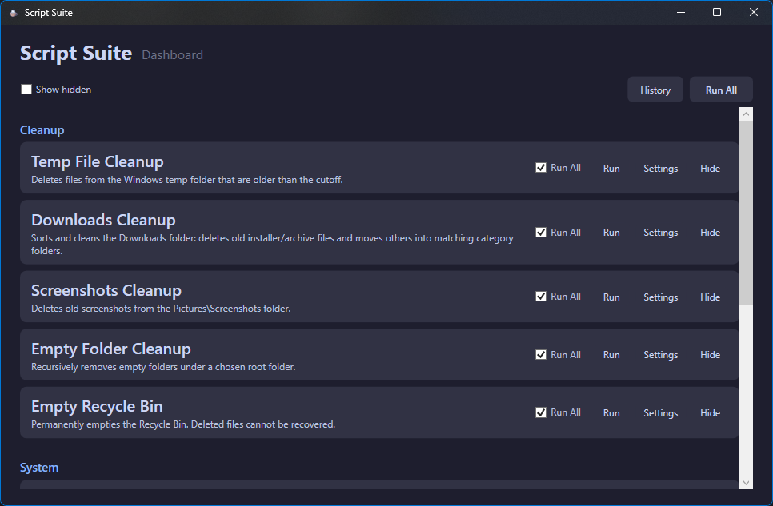

# linux-scripts


[](https://github.com/catppuccin/catppuccin)

A Linux maintenance suite — an Avalonia dashboard (`ScriptSuite`) over eight self-contained Bash scripts for cleanup, system tasks, and diagnostics. For most users it's a normal desktop app (install the `.deb`, launch); for developers the same scripts run directly via Bash and the app builds from source. Linux counterpart of [windows-scripts](https://github.com/Bllodwolfie/windows-scripts) (scope items #1 per-script Linux mapping and #2 Avalonia architecture).

## Preview



*ScriptSuite dashboard in Mocha dark — one tile per script with Run, Schedule, Settings, Hide and Run All selection. Run All, History and Scheduled history live in the header.*

> Screenshots are supplied separately — see `assets/README.md`.

## Install — for most users (no SDK needed)

**Latest Release:** [`v1.0.0` — `ScriptSuite v1.0.0`](https://github.com/Bllodwolfie/linux-scripts/releases/tag/v1.0.0)

1. Download `scriptsuite_1.0.0_amd64.deb` from the release.
2. Install it: `sudo dpkg -i scriptsuite_1.0.0_amd64.deb` (pulls in `pkexec`, `polkitd`, `jq`, `xdg-user-dirs`, `systemd`, `libglib2.0-bin` if missing).
3. Launch `ScriptSuite` from the app menu. First launch shows the first-run wizard (per-script settings, skippable).

Self-contained single-file publish (`/usr/lib/scriptsuite/ScriptSuite`) — no .NET runtime to install. The polkit action (`org.scriptsuite.run-elevated`) ships in the package, so admin scripts prompt graphically with no extra setup. To remove: `sudo apt remove scriptsuite` (keeps `~/.config/scriptsuite` data — configs, history, schedules).

*Requires Ubuntu 24.04+ / Debian 12+ (x64) or derivatives. Wayland and X11 both work.*

## Build from source — for developers

**Prerequisite:** [.NET 8 SDK](https://dotnet.microsoft.com/download) (`8.0.x`, `dotnet --version` should print `8.0.400+`). The app builds `src/ScriptSuite/ScriptSuite.csproj:8` (`net8.0`; never `net*-desktop`).

```bash
git clone https://github.com/Bllodwolfie/linux-scripts.git
cd linux-scripts

dotnet build src/ScriptSuite -c Release -r linux-x64
dotnet run --project src/ScriptSuite -c Release

# .deb from a clean tree (see .github/workflows for the CI form)
dpkg-buildpackage -us -uc
```

`dotnet publish -c Release -r linux-x64 --self-contained -p:PublishSingleFile=true -p:InvariantGlobalization=true` (see `debian/rules`) produces the single binary the `.deb` ships (`**/bin/`, `**/obj/` are gitignored).

**Run scripts directly (no dashboard):**

```bash
./scripts/SystemHealthReport/SystemHealthReport.sh --config-path ~/.config/scriptsuite/configs/SystemHealthReport.json
./scripts/TempCleanup/TempCleanup.sh --dry-run
```

## The 8 scripts

Descriptions are verbatim from `src/ScriptSuite/Manifests/*.json` (source of truth for what ships; `RestorePoint` is dropped — no System Restore equivalent).

| Script | What it does | Requires admin |
|--------|--------------|----------------|
| [SystemHealthReport](scripts/SystemHealthReport/) | Generates a self-contained HTML report of system health (CPU, memory, disks, network, errors). | No |
| [ClearJournal](scripts/ClearJournal/) | Exports then vacuums the systemd journal (CPU, boot and service logs). The export is a snapshot for inspection, not a restorable backup. | **Yes** |
| [DownloadsCleanup](scripts/DownloadsCleanup/) | Sorts and cleans the Downloads folder: deletes old installer/archive files and moves others into matching category folders. Supports Advanced per-extension rules (Ignore/Delete/MoveTo) that override the simple `Extensions to delete` list. | No |
| [EmptyFolderCleanup](scripts/EmptyFolderCleanup/) | Recursively removes empty folders under a chosen root folder. | No |
| [EmptyTrash](scripts/EmptyTrash/) | Permanently empties the XDG Trash. Deleted files cannot be recovered. Supports “Only delete items older than N days” (0 = everything). | No |
| [ScreenshotsCleanup](scripts/ScreenshotsCleanup/) | Deletes old screenshots from the Pictures/Screenshots folder. | No |
| [SoftwareInventory](scripts/SoftwareInventory/) | Generates a text report of all installed software. | No |
| [TempCleanup](scripts/TempCleanup/) | Deletes files from the temporary directory that are older than the cutoff. Permanent delete (not via Trash) — /tmp is tmpfs. | No |

Defaults live in `src/ScriptSuite/DefaultConfigs/*.json` and copy to `~/.config/scriptsuite/configs/` on first run (`Services/AppPaths.cs` `EnsureConfigsSeeded`, never overwrites existing):

- `ClearJournal` → `Scope: system`, `VacuumTime: 7d`, `BackupDir: $HOME/Documents/Script_Logs/JournalBackups`
- `DownloadsCleanup` → `SourceDir: $HOME/Downloads`, `CutoffDays: 7`, `LogDir: $HOME/Documents/Script_Logs` (+ `DeleteExts` / `IgnorePatterns` / `Categories` / `AdvancedRules`)
- `EmptyFolderCleanup` → `TargetFolder: $HOME/Downloads` (+ `IgnoreFolders`)
- `EmptyTrash` → `MinAgeDays: 0`
- `ScreenshotsCleanup` → `TargetFolder: $HOME/Pictures/Screenshots`, `CutoffDays: 7`
- `SoftwareInventory` → `OutputFile: $HOME/Documents/Script_Logs/Software_Inventory.txt`
- `SystemHealthReport` → `OutputDir: $HOME/Documents`, `OutputFile: System_Health_Report.html`
- `TempCleanup` → `TargetFolder: /tmp`, `CutoffDays: 7` (+ `IgnoreFolders`)

Each script supports dry-run preview where `supportsDryRun: true` in its manifest (6 of 8; `SoftwareInventory` and `SystemHealthReport` are reports, not previews).

*Sample `System Health Report` output — see `assets/preview.png`.*

## Prerequisites

- **For the `.deb`:** Ubuntu 24.04+ / Debian 12+ x64. No .NET runtime, no Bash version check (self-contained).
- **For `scripts/` directly:** any Linux with Bash 5+, `jq`, `gio` (Trash support), `journalctl` (ClearJournal), `systemctl --user` (scheduling).
- **For building:** .NET 8 SDK (`8.0.x`), `dpkg-dev` + `debhelper-compat` for the `.deb`, `lintian` for the lint check.

## Scheduling — unattended runs via systemd user timers

Every non-admin script (7 of 8) can be scheduled from its tile **Schedule…** button. The dialog is `Every [N] [Days|Hours|Weeks] at [HH:mm]` — no cron. Example: `Every 1 Days at 09:00` creates the `scriptsuite-TempCleanup.timer` user unit.

* **Admin scripts can't elevate on a timer:** user timers run as your user, so a scheduled `ClearJournal` run is recorded as `Failed` at execution — the dialog says so upfront. Run it manually (polkit prompt) instead. This replaces the Windows `S4U`/`HighestAvailable` split: on Linux there is no silent-elevation tier.
* **Per-script risk opt-in:** first time you touch an admin script, check `I understand the risks` (stored in `~/.config/scriptsuite/risk-consents.json` per-script, persists after unscheduling).
* **Scheduled History is separate:** header `Scheduled…` button opens `Scheduled History` (`Services/RunHistoryStore.cs` `ScheduledRuns` table, `INSERT` via headless `ScriptSuite --scheduled-run <id>`). Manual `History…` and scheduled history are never merged. `Skipped — app was busy` is a distinct outcome (not silently dropped, not queued) when a trigger fires while the dashboard holds the lock (`flock` on `~/.local/share/scriptsuite/scheduled.lock`).
* **App remains closed between runs:** the timer launches `ScriptSuite --scheduled-run <id>` headlessly, it runs, inserts into `ScheduledRuns`, and exits — no tray/background process. Results only visible in the `Scheduled…` window (no notifications).
* **Storage:** schedules in `~/.config/scriptsuite/schedules.json` (`Models/ScheduleEntry.cs`), `risk-consents.json`, and `history.db` `ScheduledRuns`. `Remove schedule` in the same dialog disables the timer and clears the entry (dashboard `◷` indicator disappears).

## Themes

Dashboard header `Theme: Dark / Latte` toggles Catppuccin Mocha (dark, `#1E1E2E`) and Latte (light, `#EFF1F5`). The switch is runtime — no restart required — and persists to `~/.config/scriptsuite/theme.json` (default Dark, so existing installs are unaffected). All windows — dashboard, Settings, Run, History, Run All, Schedule, wizard — follow the selected palette via `DynamicResource` (`Themes/Tokens.axaml` / `Themes/Tokens.Latte.axaml`), and the Fluent variant pins to match.

## Help

Contextual `?` buttons appear in the dashboard header (overview), each script's Settings window (overview next to the script name + per-field `?` for `helpDetail`), the Run window (next to the script name), and the Schedule dialog (next to the title). Click to expand a themed panel — not a separate manual. The first-run wizard reuses `SettingsForm`, so per-field `?` appears there too. History windows intentionally have no extra help (Windows P2/P3 parity).

## Self-tests and regression suite

- **In-app headless stages** (dashboard `Run self-tests`, or `ScriptSuite --self-test`): stages 2–7 cover scripts, elevation, scheduling and packaging; stages 8–9 cover the Run/History/Run-All/Settings/wizard ViewModels, validation, config round-trips and the wizard marker — all against scratch `HOME`/`XDG_*` and scratch DBs (`Services/Stage8SelfTest.cs`, `Services/Stage9SelfTest.cs`).
- **Bash regression scripts** (`tests/`, ported from `windows-scripts` `tests/m12`): parameterized per-script scenarios over `mktemp -d` scratch dirs — `tests/run.sh` runs them all, no hardcoded paths, no `sudo`.

## Threat model — privilege boundary (pkexec)

- **What polkit guarantees:** the action `org.scriptsuite.run-elevated` pins the binary path and `argv1` (`--elevated-run`). Everything after that — script id, config/result/live-log/include paths — is **attacker-controlled on direct invocation** and is validated **inside the child on every run** (`Services/ElevatedArgValidator.cs`), never only in the parent.
- **Post-auth = root-equivalent:** anyone who can pass the `auth_admin` prompt can already `pkexec` a shell, so this hardening does not (and cannot) contain a malicious administrator. What it contains is the **confused deputy**: root acting on user-writable configs, symlink/hardlink plants, and predicted temp names — plus accidents.
- **Child-side gates:** unknown script ids and non-`requiresAdmin` manifests abort with exit 2 (only `ClearJournal` is elevation-eligible); the caller's in-app risk consent is re-checked from the `PKEXEC_UID` user's own store; a present-but-garbage `--include-only` aborts instead of widening to unrestricted; result/live-log paths must match `scriptsuite_<32 hex>.json…`, live under the caller's `/run/user/$UID` or temp dir, be caller-owned, symlink-free, and are created `O_EXCL|O_NOFOLLOW` (never truncated); the config must live in the caller's `~/.config/scriptsuite/`.
- **Why not setpriv-drop or pre-opened FDs:** the script phase needs root throughout and the bash boundary takes paths, not file descriptors — rewriting every script write-site for fd-passing is disproportionate. Name validation at open time plus exclusive creates close the same vectors with a smaller auditable surface. The one place this rule is beaten: `ClearJournal`'s export goes further — root never opens the user path at all. All export bytes flow `journalctl | setpriv --reuid=$PKEXEC_UID … cat` (uid:gid of the pkexec caller, else ourselves; `--clear-groups` only when root since `setgroups` is EPERM otherwise), with a single noclobber open for the whole run, so a mid-run `BackupDir` swap redirects nothing (proven by the swap test: pre-Batch2 code leaked 50/60 lines into the victim dir, current code 0/60).
- **`ClearJournal` BackupDir:** canonicalised, then matched against an allow-list (anything strictly under the invoking user's home, resolved from the passwd entry in the privileged tier — never root's `$HOME`) plus prefix-matched system roots (`/etc`, `/usr`, `/root`, …; `/run` deliberately unlisted since scripts use `/run/user/$UID`); `$HOME` itself and `/` stay exact-match refusals. Existing components must be symlink-free and caller-or-root-owned, export name carries a PID+`$RANDOM` suffix. The validation stays as defence in depth (clear errors + mkdir backstop) in front of the setpriv writer.
- **Residual risks (documented, accepted):** ancestor-directory swap TOCTOU between validation and use elsewhere (needs `openat2`/`RESOLVE_BENEATH` to close fully); the empty-export `-s` check and the failure-path `rm -f` still name the user path as root (metadata read and non-following unlink only — no content follows symlinks); HTML reports embed host data — values are escaped/validated, but open reports only from runs you trust; operational logs/exports inherit the umask (Batch 5 hardens to 077).
- **Test hook:** `SCRIPTSUITE_FORCE_PRIVILEGED_CHECK=1` forces the privileged tier with caller = current user. Strictness-only (can never loosen a check); exercised by `tests/test-elevation-argv.sh` with no real pkexec anywhere.

## Known limitations & notices

- **Unsigned, un-sandboxed:** the `.deb` is unsigned (no SecureBoot/MOK story yet) and the app runs unconfined — scripts act with your user's full rights (plus polkit for ClearJournal). Review `scripts/` before running.
- **Intentional divergences from windows-scripts** (not bugs):
  - `RestorePoint` dropped (no System Restore equivalent); `EmptyRecycleBin` → `EmptyTrash` (XDG Trash); `ClearEventLogs` → `ClearJournal` (journald export + vacuum).
  - `ClearJournal`'s `VacuumTime`/`VacuumSize` retention fields are Linux-only: Windows `ClearEventLogs` has no retention concept (it clears every enabled non-empty log backup-first), because journald vacuum is retention-global while `wevtutil` clears per-log. Bare `VacuumTime` numbers are read as days (journalctl alone would read seconds); zero/negative/absurd values fall back to 7 days loudly.
  - Run window has a real **Cancel** (Windows has none); window-close mid-run is refused (Windows left it open).
  - History has a **filter** (Windows v2.0.0 has none).
  - **Admin scripts excluded from Run All without consent** (Windows runs them with per-leg UAC).
  - Run All preview has no per-item checkboxes (Windows parity — selection lives on the tile checkboxes).
  - No crash-resume (`journal.json`/`ResumePrompt`) yet.
  - Corrupt configs fall back to defaults but never self-heal via UI edits (Windows parity); scripts warn-and-default independently.
  - Buttons keep Fluent styling (no custom button re-template yet).
  - Dashboard shows **Recent runs** / **Scheduled runs** strips (Windows keeps recents in the History windows only).
  - Scheduling is systemd user timers (no cron, no `S4U`); intervals over a day roll from save time.
  - Both `Hide` and `Show` are guarded while a run is in flight (Windows guards only `Hide`).
- **SQLite WAL sidecars:** run history lives at `~/.local/share/scriptsuite/history.db` (`journal_mode=WAL`, `busy_timeout=5000`). Beside it you will see `history.db-wal` / `history.db-shm` — normal for WAL; don't copy the `.db` alone while the app is running.
- **Case sensitivity:** extension matching lowercases both sides (scripts + Advanced Rules UI agree); BAN pickers and path fields accept `/`-rooted paths, `~` and `$HOME`.

## License

MIT — see [LICENSE](LICENSE) (Copyright (c) 2026 Bllodwolfie). `debian/copyright` carries the same terms.
